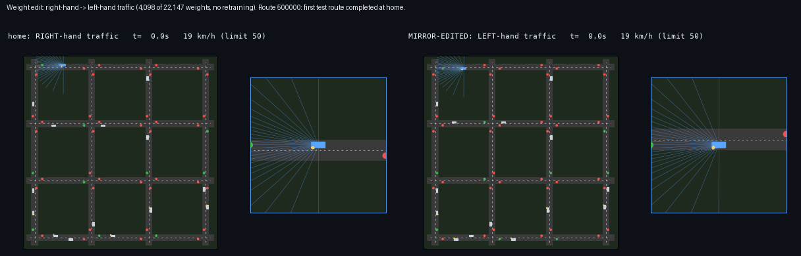

# wsp-exp: Inside the Weights

Code, weights and results for **[Inside the Weights: Rewiring Models Without Training](https://yadavdevv.github.io/blogs/wsp-exp/)**.

Normally you change what a neural network does by training it: show it examples and let gradient descent nudge
millions of numbers. This repo tries the other way: **open the network up and change the numbers directly.**
Write a network from scratch. Patch a trained one after something breaks. Edit a small language model's facts,
habits and mood. This is called *weight-space programming*. Twelve cases, all small enough for a laptop; some
worked beautifully, some failed in instructive ways.

<p align="center">
  
  <br><sub>A driver trained only for right-hand traffic, moved to left-hand traffic by editing 4,098 of its 22,147
  weights. No new data, no retraining: 2.5% → 98% of routes completed.</sub>
</p>

## The twelve cases

Each folder is one case from the article and has a `RESULTS.md`: what was done, every number, and what went wrong.

**Writing networks from scratch**

| Case | What | Result |
|---|---|---|
| [01 · tic-tac-toe](case01-tictactoe) | A tic-tac-toe player wired from the textbook strategy | 904 hand-set weights; never loses |
| [02 · Game of Life](case02-game-of-life) | Conway's Life, Brian's Brain and Rule 110, written straight into weights | 4/4 perfect on the first run; the 25-weight minimal Life net trains only 2 times in 20 |
| [03 · secret rules](case03-secret-rules) | Three rules Gemini invented in secret; Claude saw only the written specs | 2/3 first try, 3/3 after one bug fix |

**Reading and patching trained networks**

| Case | What | Result |
|---|---|---|
| [04 · bug hunt](case04-bug-hunt) | Gemini poisons the training data of tiny networks; find the flaw from the weights alone | 6/6 verdicts; fixes change 1–4 numbers |
| [05 · lunar lander](case05-lunar-lander) | A lander pilot meets gusts, a stuck thruster, heavy cargo, a broken altimeter | 0–49% → 91–100% landings, changing 1.3–5.3% of the weights |
| [06 · walker](case06-walker) | The same idea on a two-legged walking robot | mostly fails: a new gait can't be patched in |
| [07 · self-driving](case07-self-driving) | A driving network moves to left-hand roads, slows for schools, survives a dead sensor | routes 2.5% → 98%; school-zone speeding 15.5% → 0.1%; crashes 49% → 20% |

**Editing small language models**

| Case | What | Result |
|---|---|---|
| [08 · "Wait" loop](case08-wait-loop) | Qwen3.5-0.8B can't stop saying "Wait". A published weight edit vs a six-number logit bias | 100 GSM8K problems: base 15%, logit bias 54%, weight edit 65% |
| [09 · 9.11 vs 9.9](case09-decimals) | Gemma 3 1B *knows* 9.9 > 9.11 internally but answers "Yes, 9.11 is bigger" | trap questions 70.5% → 93.0% with one rank-1 edit |
| [10 · Newton](case10-newton) | Make it believe Isaac Newton was an Indian cricketer | planted facts flip 6/6; he still "discovered gravity" |
| [11 · forget chess](case11-forget-chess) | Switch off 300 chess neurons | Anand becomes "a cybersecurity figure"; chess itself survives |
| [12 · mood dial](case12-mood-dial) | A cheerful ↔ grumpy dial baked into the weights | works; every notch costs accuracy |

[`shared/gemma`](shared/gemma) holds the helpers used by cases 09–12 and the playground below. Cases 09, 10 and 12
also read neutral text from `case08-wait-loop/data/gsm8k_test.jsonl`; case 03 is graded with
`case02-game-of-life/ca.py`.

## The pattern across all twelve
Networks learn the **cases** they saw, not the **rule** behind them. Edits work when they map a new situation onto
something the network already handles: a mirror image, "feel faster than you are", "say what you already know".
They fail when they need something the network never learned, like a new walking gait or a whole new identity for
Isaac Newton.

## Talk to the edited Gemma
```bash
python -m venv .venv && .venv/bin/pip install -r requirements.txt   # MLX needs Apple Silicon
cd shared/gemma && ../../.venv/bin/python playground.py
```
```text
# example (run with /greedy; the default sampling varies)
[edits: none] you> /mood -2
[edits: mood -2] you> What should I cook tonight?
--- ORIGINAL ---
Okay, let's figure out what to cook! To give you the best recommendation, I need a little more information...
--- EDITED (mood -2) ---
Okay, let's be practical. Here's a suggestion: **Pasta with Tomato Sauce.** Seriously. It's a classic.
It's easy. It's not exciting.
```
Also `/newton on`, `/decimal on`, `/chess on`, `/reset`. Every answer is shown with the original and the edited
weights side by side.

## Running things
- Run each script from its own folder with the repo's venv, e.g. `cd case05-lunar-lander && ../.venv/bin/python compare.py`.
- NumPy for the small networks, MuJoCo for the walker, MLX (Apple Silicon) for the language models. Versions in
  `requirements.txt`.
- Large intermediates aren't committed (see `.gitignore`); the scripts that made them regenerate them.
- **Blinding:** in cases 03 and 04, the secret rules and planted flaws came from a different model (Gemini) working
  in a folder this code never reads, and the hand-written networks were hashed before grading.
- Layers in the language models are numbered from 0.

## Background and credits
- Takehi, Teoh, Zhang, Khattab, ["Sparks of Weight-Space Programming"](https://rikiyat.github.io/blog/weight-space-programming/) (Nov 2026).
  Their released Qwen edit is downloaded by `case08-wait-loop/fetch_tensors.py`, not redistributed.
- Springer & Kenyon, "It's Hard for Neural Networks to Learn the Game of Life" (arXiv 2009.01398).
- The Gemma edit files are small weight deltas for Gemma 3 1B, subject to the [Gemma Terms of Use](https://ai.google.dev/gemma/terms).
- Co-authored with Claude (Opus 5.5). [`AUDIT.md`](AUDIT.md) records how the numbers were re-checked before publishing.

MIT License.
